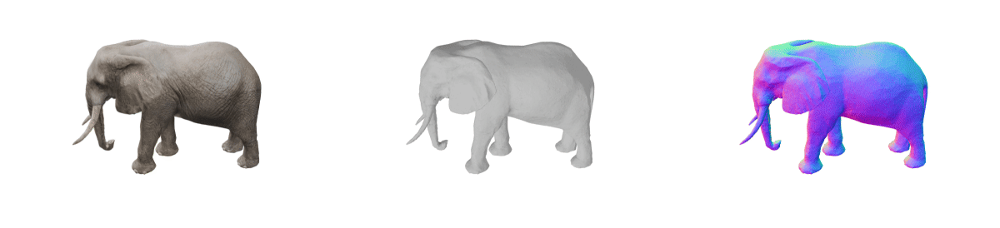
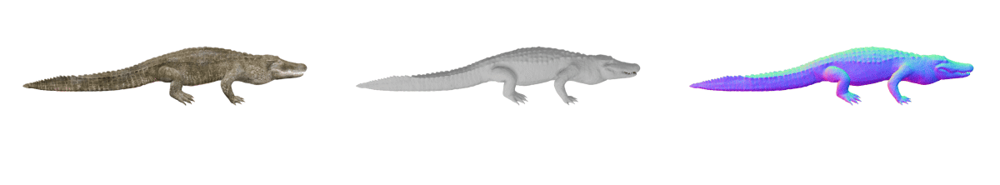
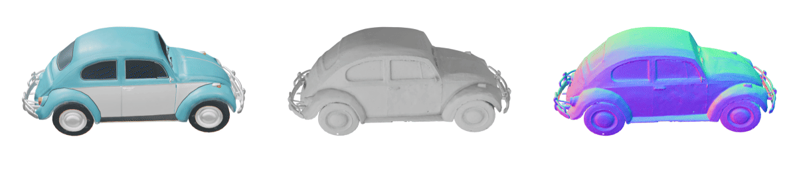

<h1 align="center">A Mesh for Every Moment</h1>

<h3 align="center">
  <a href="https://homes.cs.washington.edu/~royorel/">Roy Or-El</a><sup>1</sup> &nbsp;&nbsp;
  <a href="https://jjparkcv.github.io/">Jeong Joon Park</a><sup>2</sup> &nbsp;&nbsp;
  <a href="https://www.irakemelmacher.com/">Ira Kemelmacher-Shlizerman</a><sup>1</sup>
</h3>

<h4 align="center">
  <sup>1</sup>University of Washington &nbsp;&nbsp; <sup>2</sup>University of Michigan
</h4>

<p align="center">
  
  
  
</p>

<h3 align="center">
  <a href="https://memo-4d.github.io">Project page</a> &middot;
  <a href="https://arxiv.org/abs/2611.34939">Paper</a> &middot;
  <a href="https://github.com/royorel/Blender-Moments">Blender-Moments dataset</a>
</h3>

MEMO reconstructs a dynamic scene from multi-view video and extracts a watertight mesh at every frame, directly from its Gaussians.

## Installation and quickstart

### Requirements

- Linux
- NVIDIA GPU (40 GB of memory or more recommended)
- CUDA toolkit, with `nvcc` on the path, in a version PyTorch publishes wheels for
- gcc >= 11.0
- conda

We tested the release on Rocky Linux 8.10 with an NVIDIA A100 (80 GB) and CUDA 12.9.

### Installation

Clone the repository, then run the install script, which creates the `memo` conda environment:

```bash
git clone https://github.com/royorel/MEMO.git
cd MEMO
bash install.sh
conda activate memo
```

`install.sh` installs the newest PyTorch built for your CUDA version and builds the CUDA extensions against it. It also creates a second environment, `memo-blender`, which the video script uses to render meshes with Blender.

### Quickstart

#### Rendering and mesh extraction

Render a video and extract meshes from the released `elephant` model, without downloading any images or training:

```bash
python -m scripts.download_models --out models --scenes elephant
python -m memo.render_video -m models/blender_moments/elephant/point_cloud.ply \
    --config configs/blender_moments/elephant.yaml --renderer nvdiffrast --codec h264
python -m memo.extract_mesh -m models/blender_moments/elephant/point_cloud.ply \
    --config configs/blender_moments/elephant.yaml --evenly_spaced 10 --skip_colors
```

The video is written to `models/blender_moments/elephant/videos/full.mp4` and the meshes to `models/blender_moments/elephant/meshes/`. Dropping `--renderer nvdiffrast --codec h264` renders the mesh panels with Blender and encodes with AV1, as on the project page, which is slower.

#### Training

Download and prepare the `elephant` scene, train MEMO on it (about 15 minutes on an A100), then extract its meshes and render a video:

```bash
python -m memo.data.prepare --data_root data --scenes elephant
python -m memo.train -s data/blender_moments/elephant -m output/blender_moments/elephant \
    --config configs/blender_moments/elephant.yaml
python -m memo.extract_mesh -m output/blender_moments/elephant --evenly_spaced 10
python -m memo.render_video -m output/blender_moments/elephant --renderer nvdiffrast --codec h264
```

The meshes are written to `output/blender_moments/elephant/meshes/` and the video to `output/blender_moments/elephant/videos/full.mp4`.

## Data preparation

`memo.data.prepare` downloads, verifies, and unpacks scenes into `<data_root>/<dataset>/<scene>/` and builds their LMDBs. It prepares everything unless given `--datasets` or `--scenes`, and skips finished work on reruns.

```bash
python -m memo.data.prepare --data_root data --scenes elephant       # one scene
python -m memo.data.prepare --data_root data --datasets n3d selfcap  # two datasets
python -m memo.data.prepare --data_root data --dry-run               # list the archives
```

We train and evaluate MEMO on three datasets, which `memo.data.prepare` downloads:

| Dataset | Type | Scenes | Download |
| --- | --- | --- | --- |
| [Blender-Moments](https://github.com/royorel/Blender-Moments) | Synthetic | 9 | about 23 GB |
| [Neural 3D Video](https://github.com/facebookresearch/Neural_3D_Video) | Real | 6 | about 54 GB |
| [SelfCap](https://huggingface.co/datasets/zju3dv/SelfCap-Dataset) | Real | 7 | about 27 GB |

N3D and SelfCap come preprocessed from the [MEMO artifact repository](https://huggingface.co/datasets/royorel/MEMO-artifacts), matching the paper's runs.

### Preparing your own scene

A scene folder should be laid out as follows:

```text
my_scene/
├── transforms_train.json
├── transforms_test.json
├── frames/
│   ├── frame_0001_view_0001.png
│   ├── ...
│   └── frame_<TTTT>_view_<NNNN>.png
├── sfm_init/
│   └── frame_<t>/
│       └── colmap_points3D.ply    # one point cloud per time step, e.g. from COLMAP
└── background.ply (optional)
```

Each transforms file is NeRF-style, with one entry per image. Cameras are static: each camera has the same `transform_matrix` at every time step.

```jsonc
{
  "camera_angle_x": 0.69,                             // horizontal field of view, radians
  "frames": [
    {
      "file_path": "frames/frame_0001_view_0001.png", // relative to the scene folder, ending in _view_<NNNN>.png, 1-based camera number
      "transform_matrix": [[...], [...], [...], [0, 0, 0, 1]],  // 4x4 camera-to-world, OpenGL convention
      "t": 1,                                         // 1-based time step
      "camera_angle_x": 1.10,                         // optional, this camera's own field of view
      "camera_angle_y": 0.66,                         // optional
      "cx_cam": 945.0, "cy_cam": 532.9                // optional principal point, pixels
    }
  ]
}
```

All point clouds should be PLY files with float `x`, `y`, `z` and 8-bit `red`, `green`, `blue` fields. `background.ply` is used when the config sets `static_background_ply: background.ply`.

Then build its LMDBs:

```bash
python -m memo.data.build_lmdb --source_path data/my_dataset/my_scene
```

Transparent pixels are filled with black. To fill them with white, add `--white_background` and set `white_background: true` in the scene config:

```bash
python -m memo.data.build_lmdb --source_path data/my_dataset/my_scene --white_background
```

## Training on your own scene

Write a scene config that inherits the settings of the closest dataset: `blender_moments` for synthetic object-centric scenes over white, and `selfcap` or `n3d` for real captures with a static background. Remove `static_background_ply` if your scene has no `background.ply`.

```yaml
# configs/my_dataset/my_scene.yaml
_base_: ../selfcap/base.yaml   # the base of the most similar dataset: blender_moments, n3d, or selfcap
num_inducing: 20   # temporal resolution of the motion; the paper's scenes use 15 to 50, more for longer sequences
```

Then train:

```bash
python -m memo.train -s data/my_dataset/my_scene -m output/my_dataset/my_scene \
    --config configs/my_dataset/my_scene.yaml
```

Training records its config in the model folder, so the tools below need only `-m`:

- **`extract_mesh`** extracts the mesh of a frame to `meshes/frame_<NNNN>.ply`. Use `--all_frames` for every frame, `--evenly_spaced N` for N frames spread over the sequence, or `--times` for any times in [0, 1], between frames as well, written to `meshes/time_<t>.ply`. `--mode paper` uses the paper's extraction settings, see [Mesh extraction modes](#mesh-extraction-modes).

  ```bash
  python -m memo.extract_mesh -m output/my_dataset/my_scene --frames 30
  ```

- **`render_images`** renders the test views to `renders/test/renders/`.

  ```bash
  python -m memo.render_images -m output/my_dataset/my_scene
  ```

- **`render_video`** renders a video along the camera path set by the config to `videos/<mode>.mp4`, with the options below.

  ```bash
  python -m memo.render_video -m output/my_dataset/my_scene
  ```

| Option | Values |
| --- | --- |
| `--mode` | `full` (default), the Gaussian render beside the shaded mesh and its normals; `color`; `mesh`; `normals` |
| `--renderer` | `blender` (default), Cycles in the `memo-blender` environment, slow; `nvdiffrast`, fast |
| `--codec`, `--crf` | `av1` (default, CRF 30), slow with the best compression; `h264` and `h265` (CRF 10), fast |
| `--frames`, `--fps` | a subset of time steps; the frame rate, 25 on Blender-Moments and 30 on N3D and SelfCap by default |
| `--trajectory`, `--arc`, `--elevation`, `--start_angle`, `--direction`, `--world_up`, `--fixed_camera` | override the scene config's camera path |

## Evaluation

`evaluation.evaluate_scene` scores a scene as the paper's tables do.

### Scoring released models

One scene, in a few minutes:

```bash
python -m memo.data.prepare --data_root data --scenes elephant
python -m scripts.download_models --out models --scenes elephant
python -m evaluation.evaluate_scene --config configs/blender_moments/elephant.yaml --data_root data \
    --model models/blender_moments/elephant/point_cloud.ply --mode paper --output results/blender_moments/elephant
```

Every scene of the three datasets, then the tables (remove datasets from the `configs/{...}` list to score fewer):

```bash
python -m memo.data.prepare --data_root data
python -m scripts.download_models --out models
for config in configs/{blender_moments,n3d,selfcap}/*.yaml; do
    [ "$(basename $config)" = base.yaml ] && continue
    scene=$(basename $(dirname $config))/$(basename $config .yaml)
    python -m evaluation.evaluate_scene --config $config --data_root data \
        --model models/$scene/point_cloud.ply --mode paper --output results/$scene
done
python -m evaluation.build_tables --results results --models --out tables.md
```

Scores are written to `results/<dataset>/<scene>/model_result.json`.

### Reproducing the paper's runs

Nine training runs per scene, then the tables. This takes hours, about two for `elephant`:

```bash
python -m evaluation.evaluate_scene --config configs/blender_moments/elephant.yaml --data_root data \
    --mode paper --output results/blender_moments/elephant --n_runs 9
python -m evaluation.build_tables --results results --out tables.md
```

Every scene of the three datasets:

```bash
for config in configs/{blender_moments,n3d,selfcap}/*.yaml; do
    [ "$(basename $config)" = base.yaml ] && continue
    scene=$(basename $(dirname $config))/$(basename $config .yaml)
    python -m evaluation.evaluate_scene --config $config --data_root data \
        --mode paper --output results/$scene --n_runs 9
done
python -m evaluation.build_tables --results results --out tables.md
```

Nine runs of every scene take, on an A100:

| Dataset | GPU hours |
| --- | --- |
| Blender-Moments | about 25 |
| Neural 3D Video | about 35 |
| SelfCap | about 52 |

**We highly recommend splitting the loop across several GPUs and running scenes in parallel.**

Each run's scores go to `run_<k>/result.json` and their mean to `result.json`. Only the median run keeps its model, and finished runs are reused.

### Mesh extraction modes

- **Release** (default): removes faces whose barycenter lies in empty space, for cleaner meshes and a lower Chamfer distance on most scenes.
- **Paper** (`--mode paper`): the paper's settings, which reproduce its mesh metrics.

### Metrics

- **Images**, all datasets: PSNR, SSIM, and LPIPS (VGG).
- **Meshes**, Blender-Moments: CD (Chamfer distance ×100) and NC (normal Chamfer distance, degrees), normalized by the scene diagonal.
- **Normals**, Blender-Moments: F-scores at 20° on surface samples (F<sub>S</sub>) and on rendered normals (F<sub>R</sub>).

## Licenses

- MEMO's code is released under the [Apache License 2.0](LICENSE).
- The rasterizers, simple-knn, fused-ssim, gDel3D, and nvdiffrast keep their own licenses, listed in [LICENSES](LICENSES/README.md); the rasterizers are for non-commercial research and evaluation use.
- The released models and the processed N3D and SelfCap data are for non-commercial research: the processed data are modified versions of [Neural 3D Video](https://github.com/facebookresearch/Neural_3D_Video) (CC BY-NC 4.0) and [SelfCap](https://huggingface.co/datasets/zju3dv/SelfCap-Dataset) (its non-commercial research license), as detailed in the [artifact repository](https://huggingface.co/datasets/royorel/MEMO-artifacts).

## Acknowledgements

- Our codebase is based on [Gaussian Wrapping](https://github.com/diego1401/GaussianWrapping).
- Our rasterizer extends those of [3D Gaussian Splatting](https://github.com/graphdeco-inria/gaussian-splatting), [Mini-Splatting2](https://github.com/fatPeter/mini-splatting2), and [RaDe-GS](https://github.com/BaowenZ/RaDe-GS).
- We evaluate the vacancy field with the [SOF](https://github.com/r4dl/SOF) rasterizer.

## Citation

```bibtex
@article{orel2026memo,
  title   = {A Mesh for Every Moment},
  author  = {Or-El, Roy and Park, Jeong Joon and Kemelmacher-Shlizerman, Ira},
  journal = {arXiv preprint arXiv:2611.34939},
  year    = {2026}
}
```
